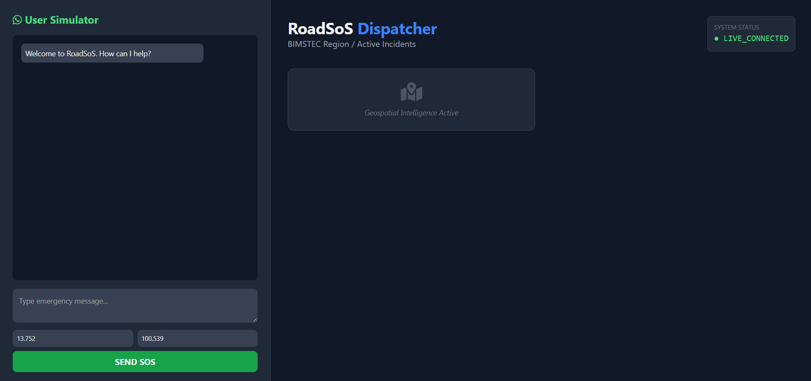

# RoadSoS - AI Emergency Dispatcher

A FastAPI service that turns a free-text road-accident report plus a GPS position into a triage score and the nearest suitable trauma centre. Built for a road-safety hackathon (2026), with a focus on the BIMSTEC region.

**Live demo:** https://roadsos-api-0nep.onrender.com

> The demo runs on a free hosting tier. If it has been idle, the first request can take a little while to wake up.



## What it does

1. A user sends an emergency message and their coordinates (the web page simulates a WhatsApp-style chat).
2. A triage step scores the severity of the situation from 1 (minor) to 5 (critical).
3. A deterministic geo module ranks facilities by Haversine distance, filtered by eligibility rules for that severity.
4. The service replies with the nearest suitable trauma centre and its phone number. If no facility is found, it tells the user to call the national emergency numbers.

## Design decisions

- **The LLM never chooses a hospital.** The language model only scores severity. Facility selection is plain code over a fixed dataset, so the service cannot invent a hospital name or phone number.
- **Fail-safe triage.** If the LLM call fails (network error, no credit, invalid output), a keyword-based fallback still produces a severity score, so the service keeps responding.
- **Eligibility rules.** Severity 5 requires a facility with a blood bank. Severity 3 and above excludes clinics.

## Tech stack

Python, FastAPI, Uvicorn, OpenAI API (`gpt-4o-mini`, JSON mode), Pydantic, plain HTML/JS front end served from `static/`. Deployed on Render.

## How it works

```
Message + lat/lng
      |
      v
TriageEngine.analyze()        LLM in JSON mode, keyword fallback on failure
      |  severity (1-5)
      v
GeoDatabase.get_nearest_facilities()   Haversine distance + eligibility rules
      |
      v
Response: nearest facility, distance, phone  (or national emergency numbers)
```

## API

### `POST /sos`

Request:

```json
{
  "message": "Car on fire, two people trapped",
  "lat": 13.752,
  "lng": 100.539
}
```

Response (example):

```json
{
  "bot_response": "Help Alerted. Nearest Trauma: Rajavithi Trauma & Emergency Hospital (1.67km). Call: +66-2-354-8101",
  "severity": 5,
  "metadata": { "severity": 5, "injured": "unknown" }
}
```

### `GET /health`

Returns `{"status": "ok"}`. Used by an uptime monitor to keep the free-tier deployment awake.

### `GET /`

Serves the dashboard page.

## Run locally

Requires Python 3.10 or newer.

```bash
git clone https://github.com/spandanareddib/roadsos-hackathon-2026.git
cd roadsos-hackathon-2026

python -m venv venv
# Windows PowerShell:  .\venv\Scripts\Activate.ps1
# macOS / Linux:       source venv/bin/activate

pip install -r requirements.txt
```

Create a `.env` file in the project root:

```
OPENAI_API_KEY=your-key-here
```

Start the server:

```bash
uvicorn src.main:app --reload
```

Open http://127.0.0.1:8000. Without a valid API key (or without credit) the app still works, using the keyword fallback for severity.

## Configuration

| Variable | Purpose |
|---|---|
| `OPENAI_API_KEY` | Key used by the triage step. Optional: if missing or rejected, the fallback is used. |

## Project structure

```
src/
  main.py            FastAPI app and routes
  triage_engine.py   LLM severity scoring with keyword fallback
  geo_database.py    Haversine ranking and eligibility rules
  config.py          Environment and system prompt loading
data/
  mock_db.json       Sample facility dataset
static/
  index.html         Dashboard and chat simulator
system_prompt.txt    Dispatcher prompt used for triage
requirements.txt
```

## Limitations

- **Sample data.** `data/mock_db.json` is a sample dataset for the demo. It is not a verified, live directory of hospitals.
- **Not a real emergency service.** This is a hackathon prototype. In a real emergency, call your local emergency number.
- **Severity only.** The service currently uses the LLM for severity and a keyword fallback; extra fields such as hazards are returned only when the model provides them.
- **Free-tier hosting.** The public demo can be slow after idle periods, and the LLM step needs API credit to run; without it, the keyword fallback answers.

## Possible next steps

- Replace the sample dataset with a maintained facility source.
- Add automated tests for the ranking rules and the fallback.
- Support more input channels (for example WhatsApp or SMS) and multiple languages in replies.
